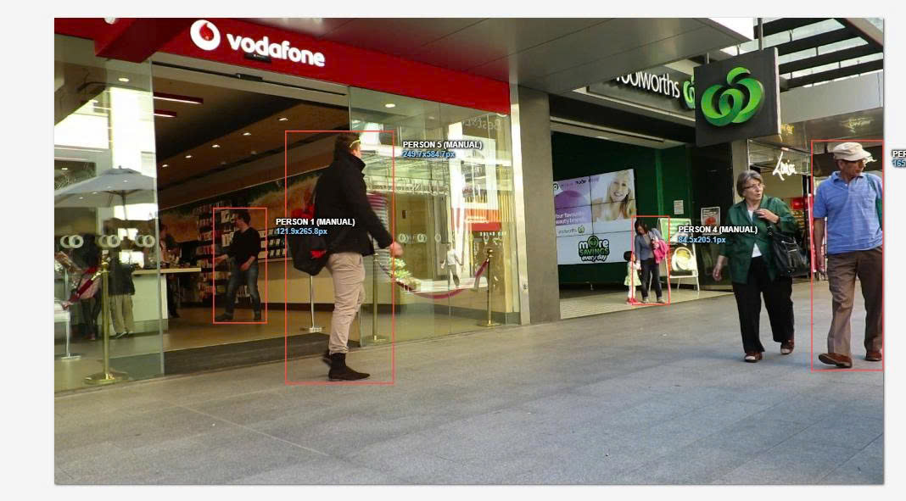
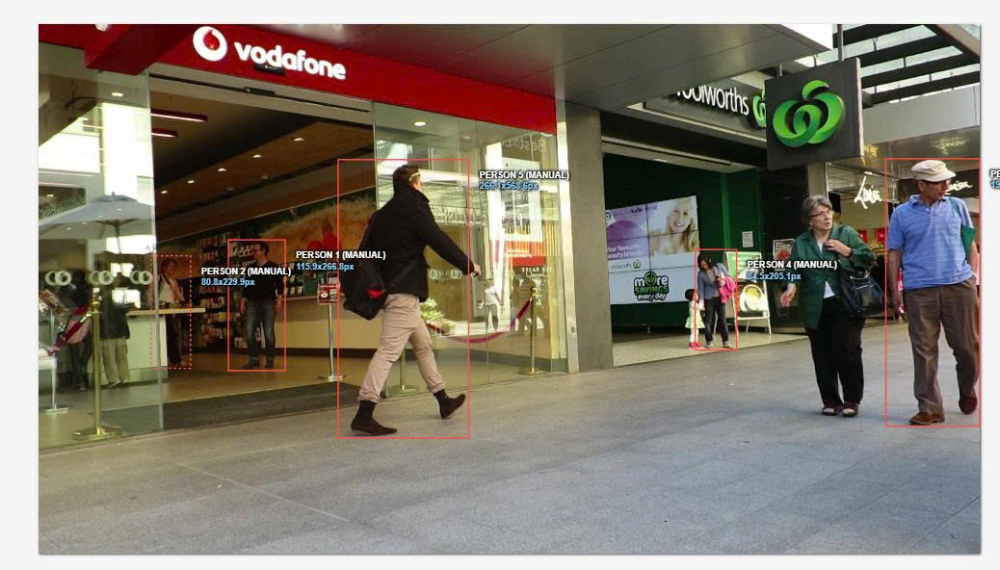
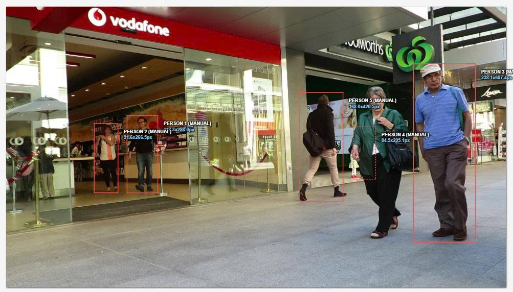

# Báo cáo cá nhân — HoVaTen-MSSV

Đổi tên file theo quy tắc `MSSV_HoTen.md`. Ví dụ: `20241234_NguyenVanAn.md`.

Đoạn video: MOT17-09, 150 frame (frame 1–150), nguồn MOTChallenge, giấy phép CC BY-NC-SA 3.0.

## 0. Thông tin học viên

- Họ tên: Vũ Tiến Vinh
- MSSV:2A202603269
- Mã đề (A/B/C): C
- Email: Vinhtbtb01@gmail.com
- Link repository: https://github.com/TienVinh03/K5-L2B-VUTIENVINH-2A202603269-MOTTracking
- Giờ bắt đầu: 17h00'
- Giờ kết thúc: 17h50'

## 1. Xem trước đoạn video (CP0)

Ghi **trước khi vẽ**, mỗi người một dòng.

| Mã | Frame xuất hiện | Frame cuối thấy được | Rẽ / dừng / đổi tốc độ ở frame | Bị che ở frame | Ghi chú |
|---|---|---|---|---|---|
| P1 | 0 | 149 | Rẽ | 25 | nhiều frame object bị che hết hoàn toàn |
| P2 | 61 | 149 | Rẽ | 61 | có nhìn thấy object qua kính trước frame 61 nhưng đến frame 61 mới nhìn rõ object rồi mới đánh |
| P3 | 0 | 149 | 0 | 0 | từ frame 0 đã thấy cánh tay có object nhưng đến frame 30 mới bắt đầu gán keyframe theo đề bài |
| P4 | 0 | 138 | Dừng | 90 | object trong 150 frame hầu như di chuyển rất ít |
| P5 | 0 | 149 | 0 | 110 | object di chuyển nhanh , từ frame 0 đã thấy cánh tay có object nhưng đến frame 28 mới bắt đầu gán keyframe theo đề bài|

## 2. Keyframe và thời gian (CP1, CP4)

Số keyframe lấy từ kết quả `src/check_submission.py`.

| Mã | Số keyframe | Keyframe ở frame | Số frame có mặt | Keyframe / 100 frame | Thời gian (phút) | Chỗ khó |
|---|---|---|---|---|---|---|
| P1 | 31 | 0, 7, 9, 11, 12, 14, 15, 17, 25, 29, 30, 31, 33, 35, 48, 51, 53, 54, 55, 58, 62, 65, 72, 85, 95, 105, 115, 125, 135, 145, 149 | 150 | 20,7 | Chưa ghi nhận | Người rẽ và bị che ở nhiều frame, cần chỉnh box tại các mốc thay đổi chuyển động và che khuất. |
| P2 | 10 | 61, 71, 81, 91, 101, 111, 121, 131, 141, 149 | 89 | 11,2 | Chưa ghi nhận | Khó nhận rõ người qua kính trước frame 61; bắt đầu gán nhãn từ frame 61. |
| P3 | 14 | 30, 40, 50, 60, 67, 70, 80, 90, 100, 110, 120, 130, 140, 149 | 120 | 11,7 | Chưa ghi nhận | Ban đầu chỉ thấy cánh tay; bắt đầu gán keyframe từ frame 30 theo đề bài. |
| P4 | 11 | 0, 10, 20, 30, 40, 50, 90, 92, 104, 124, 139 | 150 | 7,3 | Chưa ghi nhận | Người di chuyển ít, có đoạn dừng và bị che quanh frame 90. |
| P5 | 16 | 28, 38, 48, 58, 68, 78, 88, 98, 108, 110, 117, 120, 126, 131, 134, 149 | 122 | 13,1 | Chưa ghi nhận | Người di chuyển nhanh, bị che quanh frame 110; bắt đầu gán keyframe từ frame 28. |
| **Tổng** | **82** | — | **631** | **13,0** | Chưa ghi nhận riêng phần gán nhãn | Cần chú ý các đoạn rẽ, di chuyển nhanh và bị che. |

Keyframe / 100 frame của cả bài = tổng keyframe ÷ tổng số frame có mặt × 100 = 82 ÷ 631 × 100 ≈ **13,0**.

Số frame theo CVAT, bắt đầu từ 0. P1–P5 tương ứng Track 0–4 trong kết quả CVAT của script. “Số frame có mặt” đếm các box có `outside=0`, bao gồm cả frame bật `occluded`. Vì vậy, P4 được tính 150 frame theo file xuất, dù ghi chú quan sát ở mục 1 ghi frame cuối thấy được là 138. Script không đo thời gian thao tác; khoảng 17h00–17h50 ở mục 0 là thời gian toàn bài, không đủ để phân bổ thời gian cho từng người.

Bạn đặt keyframe nhiều nhất ở người nào? Vì sao (người đó rẽ, dừng, lại gần camera hay bị che)?

Em đặt keyframe nhiều nhất ở **P1**, với **31 keyframe** (20,7 keyframe / 100 frame). Theo ghi chú quan sát ở mục 1, P1 có rẽ và bị che ở nhiều frame, nên cần thêm các mốc chỉnh box để bám theo chuyển động và xử lý những đoạn che khuất.

## 3. Đoạn bị che (CP2)

Người bị che: `P2`

| Mốc | Frame |
|---|---:|
| Bắt đầu bị che một phần (bật `occluded`) | 60 |
| Mất hẳn (bật `outside`) | |
| Hiện lại (tắt `outside`) | |
| Thấy rõ trở lại (tắt `occluded`) | 101 |

- Thời gian khuất hẳn: 0 frame = 0 giây.
- Quyết định: giữ cùng ID .
- Lý do (trả lời 3 câu: khuất bao lâu so với 60 frame, ngoại hình có khớp, chỗ hiện lại có đúng hướng và tốc độ): object không bị khuất
   - khuất bao lâu so với 60 frame: nếu định nghĩa từ khuất theo occluded thì thời gian khuất là 40 frames: 
   - ngoại hình có khớp: có
   - chỗ hiện lại có đúng hướng và tốc độ: có

...

Ảnh chụp màn hình:





## 4. Tự review ID (CP3)

Lượt 1 theo người (đi ngược từ frame 149 về 0 trên CVAT), lượt 2 theo cảnh (nhảy 10 frame). Ít nhất 3 dòng; không có lỗi thì ghi một dòng "đã kiểm hai lượt, không lỗi".

Loại lỗi dùng đúng một trong 7 mã: `id_switch`, `fragmentation`, `lost`, `merge`, `false_track`, `drift`, `flag`.

| Frame | Mã người | Loại lỗi | Mô tả một câu | Phát hiện ở lượt | Đã sửa? |
|---:|---|---|---|---|---|
| 43 | P1 | flag | Khi object bị che khuất hoàn toàn bởi 1 object khác tôi đánh outside nhưng đã sửa lại thành occluded | 2 | Đã sửa |
| 82 | P2 | flag | Người bị che bởi mép bàn nhưng không đánh occluded | 1 | Đã sửa|
| 0 | P5 | flag | Khi người mới xuất hiện nửa người trong khung hình đánh occluded | 2 | đã sửa |
| 149 | P5 | lost | Người bị xuất hiện phần chân ở frame cuối cùng | 2 | Đã sửa |

Tổng hợp số lỗi theo loại:

| `id_switch` | `fragmentation` | `lost` | `merge` | `false_track` | `drift` | `flag` |
|---:|---:|---:|---:|---:|---:|---:|
| 0 | 0 | 1 | 0 | 0 | 0 | 3 |

Lỗi nào chỉ lượt 2 (theo cảnh) mới thấy, lượt 1 (theo người) không thấy? Vì sao?
Có 3 lỗi chỉ lượt 2 mới thấy, lượt 1 không thấy vì: 
- lỗi này là do labCoach chỉ do bản thân hiểu sai guideline không phải do tự check(P2b)
- không để ý kĩ phần chân ở frame thứ 149 (P5)

...

## 5. File xuất và kết quả tự kiểm (CP4)

| Kiểm tra | Kết quả |
|---|---|
| Tên file MOT 1.1 | VuTienVinh_cvat_video.zip |
| Tên file CVAT for video 1.1 | VuTienVinh_mot.zip |
| Số track ID khác nhau trong `gt/gt.txt` (phải là 5) | 5 |
| Frame `outside` không có dòng trong `gt.txt` (đúng / sai) | đúng |
| Job đã completed trên CVAT máy cá nhân | Rồi |

Dán phần tóm tắt in ra từ `src/check_submission.py`:

=== Tóm tắt ===
  Lỗi: 0   |   Cảnh báo: 0
  Đạt. Dán phần tóm tắt này vào báo cáo mục 5.

```text
...
```

## 6. Ba câu kết

1. Nếu được gán lại, bạn sẽ đặt keyframe khác ở đâu? Vì sao?

   Nếu được gán lại thì tôi sẽ đặt mỗi 10 frame 1 keyframe rồi sẽ check lại trong 10 frame đó rồi sẽ đặt thêm keyframe chuẩn hơn.

2. Có chỗ nào bạn không chắc "cùng ID hay ID mới"? Bạn đã quyết định và ghi chú thế nào?

   Có, khi P2 bị che một phần. Tôi giữ cùng ID vì ngoại hình, hướng và tốc độ vẫn khớp, đồng thời ghi lý do ở mục 3. Script ghi nhận 30 frame occluded, không bật outside; cần đối chiếu lại con số 40 frame ở mục 3.

3. Một lỗi ID trong job của bạn (nếu không còn sót, chọn lỗi đã sửa) có thể làm xe tự lái dự đoán sai chuyển động của người đó như thế nào? Lỗi đó ảnh hưởng MOTA hay IDF1 nhiều hơn?

   Tôi chọn lỗi đã sửa: bỏ sót P5 ở frame 149 (lost). Lỗi này có thể khiến xe tưởng người đã rời cảnh và dự đoán thiếu nguy cơ va chạm. Nó làm tăng FN, trực tiếp giảm MOTA và cũng có thể giảm IDF1. Chưa thể so mức ảnh hưởng vì script không tính hai chỉ số này.

## Bonus (nếu làm)

### B1 — Hai người đi sát

...

### B2 — So cách đặt keyframe

Đối tượng so sánh: **P5** (Track 4 trong file CVAT), được gán nhãn từ frame 28 đến 149.

| Cách đặt | Số keyframe | Frame trôi nhất | Ghi chú |
|---|---:|---:|---|
| Đều mỗi 30 frame | 5 | 65 | tay và chân ở frame 65 ra ngoài khung box|
| Theo chỗ đổi hướng | 16 | Không thấy trôi rõ | Theo quan sát, box bám khá sát người, không bị lệch nhiều do tốc độ di chuyển tương đối đều và ít thay đổi. |

Nội suy tuyến tính giả định đối tượng di chuyển với vận tốc không đổi giữa hai keyframe. Trong đoạn quan sát, tốc độ và hướng di chuyển ít thay đổi nên box của track chính không bị lệch nhiều. Tuy nhiên, cách đặt đều mỗi 30 frame vẫn làm tay và chân nằm ngoài box ở frame 65, cho thấy cần bổ sung keyframe khi box không còn bao sát người.

### B3 — So với tracker có sẵn

| Frame | Mã người | Tracker làm gì | Nhãn của bạn | Giải thích (đoán rồi sửa / ghép IoU / box score thấp / ngoại hình) |
|---:|---|---|---|---|
| | | | | |
| | | | | |

## 7. Tài liệu tham khảo và công cụ AI đã dùng

...
